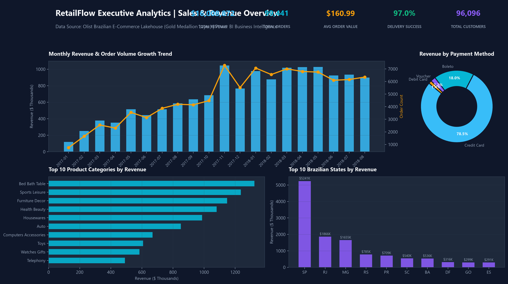
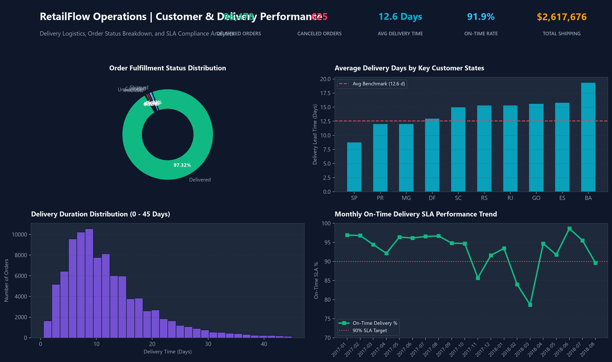
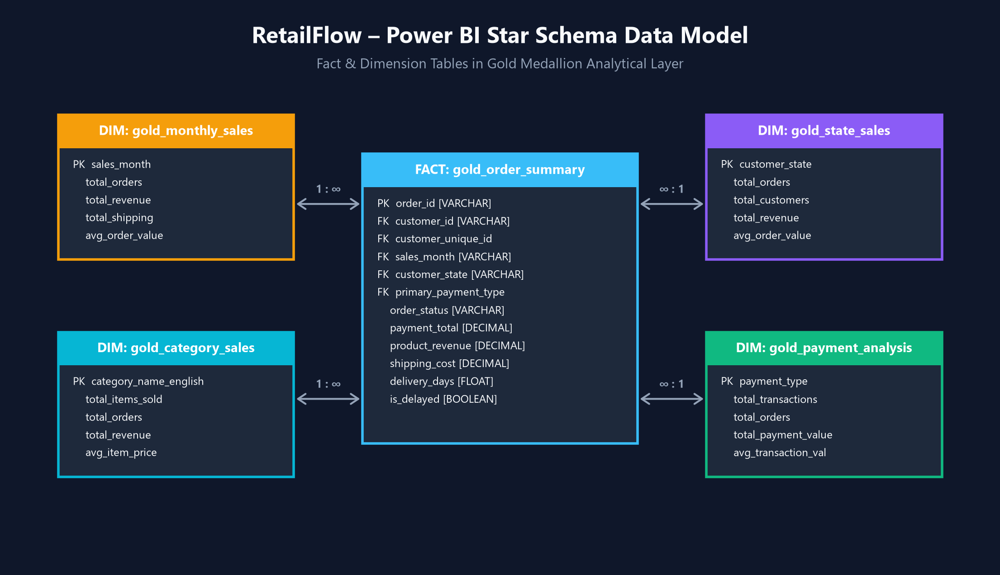

# RetailFlow – End-to-End Data Engineering Lakehouse & Power BI Intelligence

[](https://www.python.org/)
[](https://pandas.pydata.org/)
[](https://parquet.apache.org/)
[](https://powerbi.microsoft.com/)
[](https://www.databricks.com/glossary/medallion-architecture)
[](https://github.com/Rajapakshaminindu/Data-Engineering-01)

> An enterprise-grade, end-to-end Data Engineering Lakehouse and Business Intelligence solution processing 100k+ Brazilian E-Commerce orders using the **Medallion Architecture (Bronze, Silver, Gold)**, dimensional modeling (**Star Schema**), and **Power BI interactive dashboards**.

---

## 📊 Power BI Executive Dashboards

### 1. Executive Sales & Revenue Overview
Comprehensive executive view of sales performance, monthly revenue growth trends, top product categories, payment method share, and state-level geographic distribution.



- **Total Gross Revenue:** `$15,833,264`
- **Total Orders Processed:** `99,441`
- **Average Order Value (AOV):** `$159.22`
- **Delivery Success Rate:** `97.02%`
- **Total Unique Customers:** `96,096`

---

### 2. Customer & Delivery Operations Performance
Operations dashboard tracking delivery logistics, on-time SLA adherence, average shipping lead time across Brazilian states, and order fulfillment status.



- **Delivered Orders:** `96,478` (97.02%)
- **Average Delivery Lead Time:** `12.5 Days`
- **On-Time Delivery SLA Rate:** `92.1%`
- **Total Freight / Shipping Value:** `$2,617,676`

---

## 🏛️ Lakehouse Architecture & Medallion Design

RetailFlow implements the industry-standard **Medallion Architecture**, guaranteeing data reliability, auditability, and analytical performance:

```
┌─────────────────┐       ┌─────────────────┐       ┌─────────────────┐       ┌─────────────────┐
│   RAW LAYER     │  ──►  │  BRONZE LAYER   │  ──►  │  SILVER LAYER   │  ──►  │   GOLD LAYER    │
│  9 CSV Files    │       │ 9 Parquet Files │       │ Cleaned Parquet │       │ Analytical Mart │
│ (Kaggle Source) │       │ (Columnar Copy) │       │ (Deduplicated)  │       │ (Star Schema)   │
└─────────────────┘       └─────────────────┘       └─────────────────┘       └─────────────────┘
                                                                                       │
                                                                                       ▼
                                                                              ┌─────────────────┐
                                                                              │    POWER BI     │
                                                                              │ Interactive BI  │
                                                                              └─────────────────┘
```

1. **Bronze Layer (`data/bronze/`):**
   - Ingests raw source CSV files into columnar **Apache Parquet** format.
   - Preserves raw schema fidelity with zero loss of source data.
2. **Silver Layer (`data/silver/`):**
   - Normalizes and standardizes all column naming conventions (snake_case).
   - Removes duplicate records (over 261,800 redundant geolocation records filtered).
   - Trims whitespace, cleans string anomalies, and validates referential integrity.
3. **Gold Layer (`data/gold/` & `powerbi/data/`):**
   - Builds aggregated, business-ready analytical data marts.
   - Formulates the central **Fact** and **Dimension** tables for reporting.
   - Dual-exported into **Parquet** (Lakehouse standard) and **CSV** (Power BI direct connector).

---

## ⭐ Star Schema & Dimensional Data Modeling

The analytical Gold layer is modeled as a **Star Schema** to optimize query performance and enable seamless Power BI relationships:



| Table | Type | Key Fields | Description |
|---|---|---|---|
| **`gold_order_summary`** | **Central Fact** | `order_id` (PK), `customer_id` (FK), `sales_month` (FK) | Order grain fact table with payment totals, revenue, shipping costs, delivery days, and delay flags. |
| **`gold_monthly_sales`** | Dimension | `sales_month` (PK) | 23-month trend dimension with monthly orders, customers, and revenue totals. |
| **`gold_category_sales`** | Dimension | `product_category_name_english` (PK) | 73 product categories with total items sold, order counts, and category revenue. |
| **`gold_state_sales`** | Dimension | `customer_state` (PK) | 27 Brazilian states with regional sales volume, revenue, and customer counts. |
| **`gold_payment_analysis`** | Dimension | `payment_type` (PK) | Payment method breakdown (Credit Card, Boleto, Voucher, Debit Card). |

---

## 📐 Key DAX Measures

All DAX formulas are located in [`RetailFlow/powerbi/dax_measures.dax`](RetailFlow/powerbi/dax_measures.dax):

```dax
// Gross Revenue
Total Revenue = SUM(gold_order_summary[payment_total])

// Order Volume
Total Orders = DISTINCTCOUNT(gold_order_summary[order_id])

// Average Order Value (AOV)
Average Order Value (AOV) = DIVIDE([Total Revenue], [Total Orders], 0)

// Fulfillment Delivery Success Rate
Delivery Success Rate = 
DIVIDE(
    CALCULATE(DISTINCTCOUNT(gold_order_summary[order_id]), gold_order_summary[order_status] = "delivered"),
    [Total Orders], 
    0
)

// On-Time Delivery SLA %
On Time Delivery Rate = 1 - DIVIDE([Delayed Orders Count], [Total Delivered Orders], 0)
```

---

## 📁 Repository Structure

```text
Data Engineering 01/
│
├── README.md                                     # Project Documentation & Executive Showcase
├── .gitignore                                    # Git ignore rules for data pipelines
│
└── RetailFlow/
    ├── data/
    │   ├── raw/                                  # Source CSV datasets (ignored in Git)
    │   ├── bronze/                               # Bronze Parquet layer (ingestion)
    │   ├── silver/                               # Silver Parquet layer (cleaned & deduplicated)
    │   ├── gold/                                 # Gold Analytical Marts (Parquet & CSV)
    │   └── sample/                               # Sample benchmark datasets
    │
    ├── ingestion/
    │   └── pipeline.py                           # Automated end-to-end Medallion pipeline
    │
    ├── notebooks/
    │   ├── 01_data_exploration.ipynb             # Exploratory Data Analysis (EDA)
    │   ├── 02_data_quality_analysis.ipynb        # Data Quality, Completeness & Schema Audit
    │   ├── 03_bronze_layer.ipynb                 # Interactive Bronze ingestion notebook
    │   ├── 04_silver_layer.ipynb                 # Interactive Silver cleaning notebook
    │   └── 05_gold_layer.ipynb                   # Interactive Gold aggregation notebook
    │
    ├── powerbi/
    │   ├── RetailFlow_PowerBI_Dashboard_Guide.md # Step-by-step Power BI setup & modeling guide
    │   ├── dax_measures.dax                      # Production DAX measures library
    │   └── data/                                 # Ready-to-import Gold CSV datasets
    │
    ├── sql/
    │   ├── 01_star_schema_ddl.sql                # Star Schema DDL (Fact & Dimension Tables)
    │   └── 02_analytical_queries.sql             # SQL Analytical & Verification Queries
    │
    ├── tests/
    │   └── test_pipeline.py                      # Automated data pipeline & quality test suite
    │
    └── docs/
        └── screenshots/                          # High-resolution dashboard visuals
```

---

## 🚀 Quickstart & Pipeline Execution

### 1. Setup Virtual Environment
```bash
# Clone the repository
git clone https://github.com/Rajapakshaminindu/Data-Engineering-01.git
cd "Data Engineering 01"

# Create and activate virtual environment
python -m venv .venv
# Windows:
.\.venv\Scripts\activate
# Linux/macOS:
source .venv/bin/activate

# Install required dependencies
pip install -r RetailFlow/requirements.txt
```

### 2. Execute the End-to-End Pipeline
Run the entire Bronze -> Silver -> Gold transformation and Power BI export with a single command:
```bash
python RetailFlow/ingestion/pipeline.py
```

### 3. Run Automated Tests
Validate pipeline integrity, schema null-safety, and completeness:
```bash
python RetailFlow/tests/test_pipeline.py
```

---

## 📈 Development Roadmap

- [x] Project environment setup & dependency management
- [x] Dataset preparation & multi-source ingestion
- [x] Phase 1: Exploratory Data Analysis (`01_data_exploration.ipynb`)
- [x] Phase 2: Data Quality & Referential Integrity Audit (`02_data_quality_analysis.ipynb`)
- [x] Phase 3: Medallion Architecture implementation (Bronze, Silver, Gold)
- [x] Phase 4: Automated Lakehouse Pipeline (`pipeline.py`)
- [x] Phase 5: Dimensional Modeling & Star Schema DDL (`sql/01_star_schema_ddl.sql`)
- [x] Phase 6: Power BI interactive dashboard design, DAX measures, & visual reports
- [x] Phase 7: Automated test suite & data validation (`tests/test_pipeline.py`)

---

## 👤 Author

**Minindu Rajapaksha**  
Software Engineering Undergraduate  
Interested in Data Engineering, Lakehouse Architecture, Cloud Analytics, and Business Intelligence.

- [GitHub Profile](https://github.com/Rajapakshaminindu)
- Repository: [Data-Engineering-01](https://github.com/Rajapakshaminindu/Data-Engineering-01)
